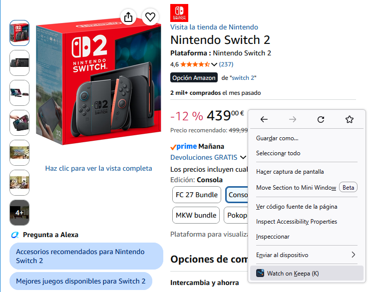
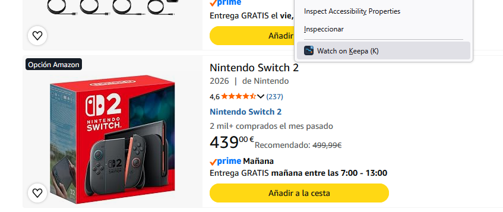
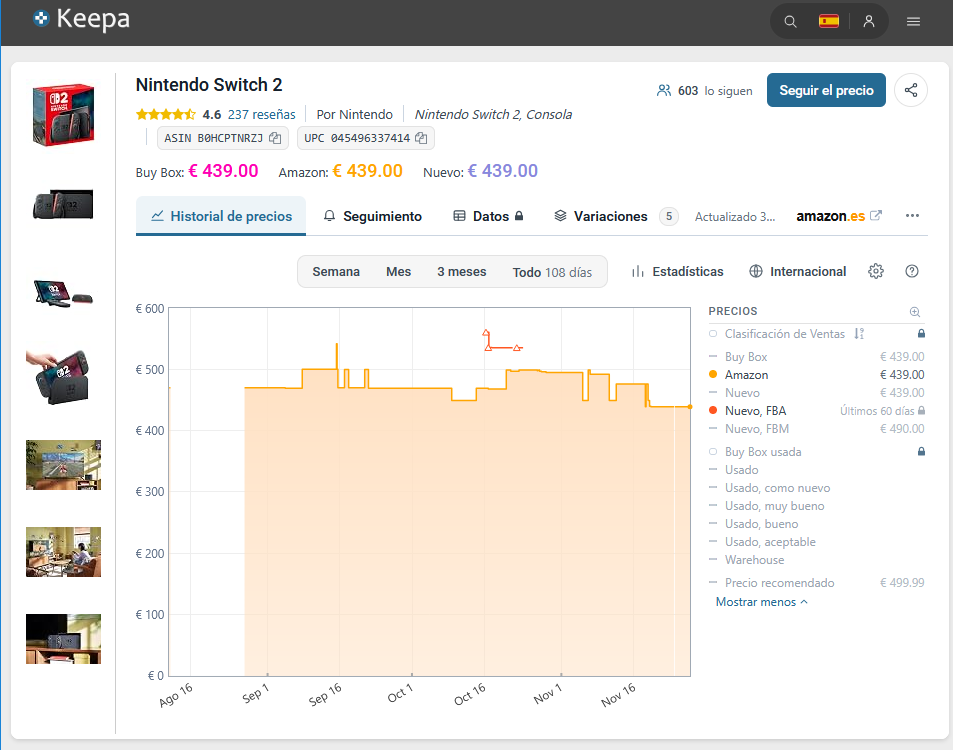

<h1>Watch on Keepa</h1>

A lightweight extension for Firefox and Firefox for Android that adds a context menu option and a toolbar button to Amazon product pages and links, allowing you to instantly view a product's price history chart on <a href="https://keepa.com">Keepa</a>.

---

## Features

- **Desktop & Android Support:** Works via right-click context menu on desktop Firefox and via the toolbar/extensions button on both desktop and **Firefox for Android**.
- **Works Directly on Links & Thumbnails:** Right-click any product link or image in Amazon search results, carts, or order lists—no need to open the product page first.
- **One-Click Page Lookup:** Right-click anywhere inside an Amazon product page and select **Watch on Keepa (K)** (or press `K` while the context menu is open), or simply tap the extension icon.
- **Adjacent Tab Opening:** Opens the Keepa chart right next to your active tab for seamless browsing.
- **Automatic ASIN & Domain Detection:** Extracts the 10-character ASIN from `/dp/`, `/gp/product/`, `/gp/aw/d/`, or `/ASIN/` URLs and maps the corresponding Keepa country code automatically.
- **Fallback Text Search:** If triggered without a direct product ASIN in the URL, it searches Keepa using your highlighted text or link text.
- **Supported Amazon Stores:** `.com`, `.co.uk`, `.de`, `.fr`, `.co.jp`, `.ca`, `.it`, `.es`, `.in`, `.com.mx`, `.com.br`, `.com.au`, and `.nl` (all Keepa-supported locales).
- **Zero Bloat:** No trackers, no content scripts injecting into Amazon, and no account required.

## Screenshots

| Product Page Context Menu | Direct Link Context Menu | Instant Keepa Price History |
| :---: | :---: | :---: |
|  |  |  |

## Installation (Temporary / Development)

1. Clone or download this repository to your local machine.
2. Open Firefox and navigate to `about:debugging`.
3. Click **This Firefox** in the left sidebar.
4. Click **Load Temporary Add-on...**.
5. Select the `manifest.json` file inside the `watch-on-keepa` folder.

## Usage

1. Open any supported Amazon store (e.g., `amazon.es` or `amazon.com`).
2. **Desktop:** Right-click directly over a product link/thumbnail, anywhere on a product page, or on highlighted text and click **Watch on Keepa (K)** (or press `K`).
3. **Android / Toolbar:** Open a product page and tap the **Watch on Keepa** button from the extensions menu.

## Disclaimer

**Watch on Keepa** is an independent, unofficial third-party browser extension. It is **not** affiliated with, endorsed by, sponsored by, or in any way officially connected with **Keepa** (`keepa.com`), **Amazon**, or any of their subsidiaries or affiliates.

All product names, logos, trademarks, and registered trademarks—including **Keepa** and **Amazon**—are the property of their respective owners. Their use in this project is strictly for identification and descriptive purposes only.

## License

Copyright © 2026 NeKuNeKo. **All Rights Reserved.**

This source code is made visible for reference only. Copying, modifying, distributing, or using this software commercially without explicit written permission from the author is strictly prohibited.
